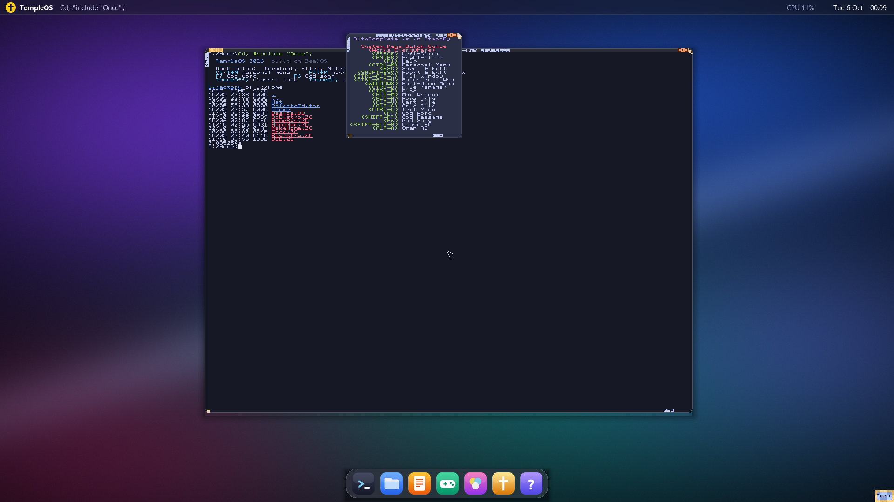

# TempleOS 2026

Это ZealOS (современный форк TempleOS), к которому я написал собственный 32-битный компоновщик экрана на HolyC. VM в VirtualBox называется **TempleOS2026**.



## Запуск
1. В VirtualBox запусти **TempleOS2026**. Она откроется на весь экран (1920×1080). Выйти из полноэкранного режима: правый Ctrl+F.
2. В меню `ZealOS Boot Loader` нажми **1** (Drive C). Если тема когда-нибудь сломается, жми **2**: на диске D лежит чистый ZealOS.

## Что внутри
- Разрешение 1920×1080 вместо 640×480 (ядро пересобрано, `KStart16.ZC`).
- Обои-аврора в настоящем 32-битном цвете, мягкие тени и скруглённые углы окон.
- Стеклянная верхняя панель: логотип, заголовок активного окна, загрузка CPU, дата и время, шрифт Segoe UI со сглаживанием.
- Док снизу: Terminal, Files, Notes, Games, Graphics, Oracle (GodWord), Help. Название кнопки под мышью показывается в панели.
- Тёмная палитра в стиле Tokyo Night, окна открываются каскадом по центру.
- `ThemeOff;` возвращает классический вид, `ThemeOn;` включает 2026 обратно.

## Как это устроено
| Файл | Назначение |
|---|---|
| `theme/Theme/Theme.ZC` | компоновщик, панель, док, маска окон |
| `theme/Sys/GrScreen.ZC` | системный хук `fp_theme_update32` (при сбое темы система откатывается на стандартный рендер) |
| `theme/Sys/Win.ZC` | развёрнутые и тайловые окна не залезают под панель и док |
| `theme/Sys/KStart16.ZC` | 1920×1080 |
| `theme/Home/HomeSys.ZC`, `Once.ZC` | автозагрузка темы и приветствие |
| `tools/make_assets.py` | генерирует обои, стекло, иконки и шрифт |
| `tools/patch_system.py` | делает патчи из исходников ZealOS (`src/`) |
| `tools/make_iso.py` | собирает `THEME.ISO` для передачи файлов в VM |

## Сборка с нуля
В репозитории нет исходников ZealOS, сгенерированной графики и ISO-образов. Их можно получить заново:
```bash
git clone --depth 1 https://github.com/Zeal-Operating-System/ZealOS.git src
pip install pillow numpy pycdlib
python tools/make_assets.py
python tools/patch_system.py
python tools/make_iso.py
```
Дальше поставь ZealOS (PublicDomain BIOS ISO) в VM с SATA-диском, подключи `THEME.ISO` и в терминале ZealOS выполни `DiskChange('T');`, затем `#include "T:/Install";` (пересоберёт ядро под 1920×1080) и `Reboot;`.

## Как обновить тему
1. Пересобери ISO:
   ```bash
   python tools/make_iso.py
   ```
2. Подключи `THEME.ISO` к оптическому приводу VM.
3. В терминале ZealOS выполни по очереди (если CD не виден с первого раза, повтори `DiskChange`):
   ```
   DiskChange('T');
   #include "T:/Update";
   Reboot;
   ```
